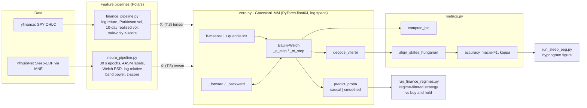
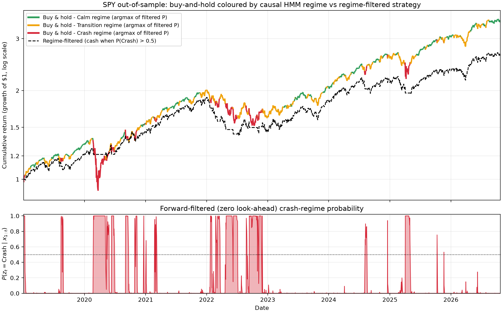
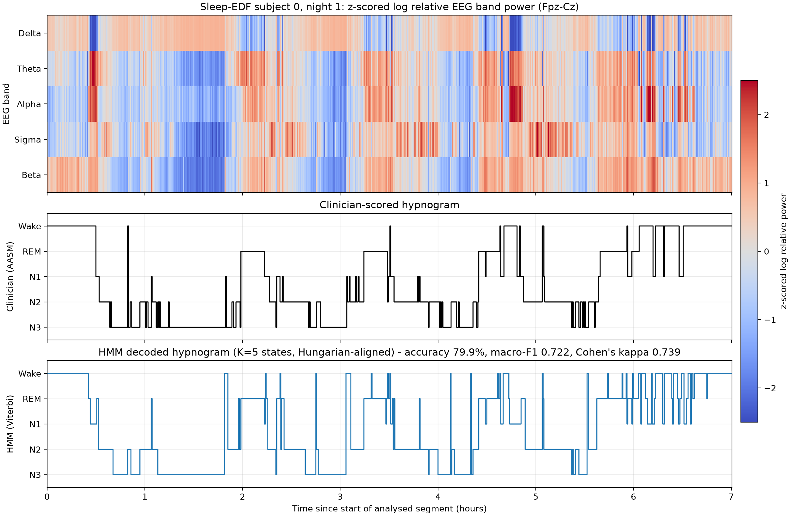

# regime-hmm-engine

A multivariate **Gaussian Hidden Markov Model** written from scratch in **pure PyTorch (`float64`)**, with Baum-Welch EM, forward filtering, backward smoothing and Viterbi decoding all carried out **strictly in log-probability space**. The same engine is benchmarked on two very different latent-regime problems:

| Domain | Data | Question | Inference mode |
|---|---|---|---|
| Finance | S&P 500 ETF (`SPY`), daily, 2005-2026 | Is the market in a calm, transitional or crash regime? | **Causal** forward filtering, $P(z_t \mid \mathbf{x}_{1:t})$ - zero look-ahead |
| Neuroscience | PhysioNet Sleep-EDF, EEG `Fpz-Cz`, subject 0 night 1 | Which sleep stage is the brain in? | **Offline** forward-backward smoothing / Viterbi, scored against clinician hypnograms |

## Contents

- [Why one model for markets and brains?](#why-one-model-for-markets-and-brains)
- [Mathematical overview](#mathematical-overview)
- [Architecture](#architecture)
- [Installation](#installation)
- [Quick start](#quick-start)
- [Running the benchmarks](#running-the-benchmarks)
- [Benchmark results](#benchmark-results)
- [Tests](#tests)
- [Design notes and limitations](#design-notes-and-limitations)
- [Repository layout](#repository-layout)
- [Learning guide](#learning-guide)
- [AI assistance](#ai-assistance)

## Why one model for markets and brains?

Financial markets and the sleeping brain share the same statistical skeleton:

1. **A hidden discrete state that persists.** Volatility regimes last weeks to months; sleep stages last minutes. In both cases the state is "sticky", so the diagonal of the transition matrix is close to one.
2. **Noisy, continuous observations whose distribution depends on the state.** Daily range and return statistics shift between calm and crisis markets; the spectral content of the EEG (delta, spindle, alpha, ... power) shifts between stages.
3. **No labels at training time.** Regimes are not announced and the model is fitted by maximum likelihood (EM).

What differs is the *question you are allowed to ask*, and this is exactly what the two benchmarks highlight:

- A trader may only use information available **at time $t$**, so the engine exposes the filtering distribution $P(z_t \mid \mathbf{x}_{1:t})$ and the test suite proves that it never depends on $\mathbf{x}_{t+1:T}$.
- A sleep scorer reviews a finished recording, so the engine exposes the smoothing distribution $P(z_t \mid \mathbf{x}_{1:T})$ and the Viterbi path, which use the whole night.

## Mathematical overview

### Model

Hidden states $z_t \in \{1,\dots,K\}$ follow a first-order Markov chain, and each state emits a full-covariance Gaussian vector $\mathbf{x}_t \in \mathbb{R}^D$:

$$
p(z_1 = k) = \pi_k, \qquad p(z_t = j \mid z_{t-1} = i) = A_{ij}, \qquad
\mathbf{x}_t \mid z_t = k \;\sim\; \mathcal{N}(\boldsymbol{\mu}_k, \boldsymbol{\Sigma}_k).
$$

Emission log-densities are evaluated with batched Cholesky factors $\boldsymbol{\Sigma}_k = \mathbf{L}_k \mathbf{L}_k^\top$ (triangular solves, no explicit inverses):

$$
\log b_k(\mathbf{x}_t) = -\tfrac12\Big[D\log 2\pi + 2\sum_d \log L_{k,dd} + \lVert \mathbf{L}_k^{-1}(\mathbf{x}_t - \boldsymbol{\mu}_k)\rVert_2^2\Big].
$$

### Log-space forward-backward

With $\log\alpha_t(k) = \log p(\mathbf{x}_{1:t}, z_t = k)$ and $\log\beta_t(k) = \log p(\mathbf{x}_{t+1:T} \mid z_t = k)$:

$$
\log\alpha_t(j) = \log b_j(\mathbf{x}_t) + \operatorname{LSE}_i\big[\log\alpha_{t-1}(i) + \log A_{ij}\big],\qquad
\log\beta_t(i) = \operatorname{LSE}_j\big[\log A_{ij} + \log b_j(\mathbf{x}_{t+1}) + \log\beta_{t+1}(j)\big],
$$

where $\operatorname{LSE}$ is `torch.logsumexp`, $\log\alpha_1 = \log\boldsymbol{\pi} + \log \mathbf{b}(\mathbf{x}_1)$ and $\log\beta_T = 0$. The sequence log-likelihood is $\log p(\mathbf{x}_{1:T}) = \operatorname{LSE}_k \log\alpha_T(k)$. No probability is ever multiplied in linear space, so long sequences cannot underflow.

### Filtering, smoothing, decoding

$$
\underbrace{P(z_t = k \mid \mathbf{x}_{1:t}) = \frac{\alpha_t(k)}{\sum_j \alpha_t(j)}}_{\texttt{predict\_proba(causal=True)}},
\qquad
\underbrace{P(z_t = k \mid \mathbf{x}_{1:T}) = \frac{\alpha_t(k)\,\beta_t(k)}{p(\mathbf{x}_{1:T})}}_{\texttt{predict\_proba(causal=False)}}.
$$

Viterbi decoding replaces $\operatorname{LSE}$ by $\max$, stores arg-max back-pointers $\psi_t(j)$ and backtracks to obtain $\hat{z}_{1:T} = \arg\max_{z_{1:T}} p(z_{1:T}, \mathbf{x}_{1:T})$.

### Baum-Welch (EM)

The E-step computes the state posteriors $\gamma_t(k)$ and the expected transitions $\xi_t(i,j) = P(z_t = i, z_{t+1} = j \mid \mathbf{x}_{1:T})$, all in log space:

$$
\log\xi_t(i,j) = \log\alpha_t(i) + \log A_{ij} + \log b_j(\mathbf{x}_{t+1}) + \log\beta_{t+1}(j) - \log p(\mathbf{x}_{1:T}).
$$

The M-step has closed-form updates (normalisations via log-sum-exp):

$$
\pi_k = \gamma_1(k),\qquad
A_{ij} = \frac{\sum_{t}\xi_t(i,j)}{\sum_{t}\sum_{j'}\xi_t(i,j')},\qquad
\boldsymbol{\mu}_k = \frac{\sum_t \gamma_t(k)\,\mathbf{x}_t}{\sum_t\gamma_t(k)},
$$

$$
\boldsymbol{\Sigma}_k = \tfrac12\left(\mathbf{S}_k + \mathbf{S}_k^\top\right) + \varepsilon\,\mathbf{I},\qquad
\mathbf{S}_k = \frac{\sum_t \gamma_t(k)(\mathbf{x}_t - \boldsymbol{\mu}_k)(\mathbf{x}_t - \boldsymbol{\mu}_k)^\top}{\sum_t\gamma_t(k)}.
$$

The symmetry projection plus the diagonal term $\varepsilon = $ `reg_covar` keeps every covariance symmetric positive definite (a jitter-escalating Cholesky is the last line of defence). EM is initialised from **k-means++/Lloyd** clustering (or equal-mass **quantile** bins) and stops when the log-likelihood gain per observation drops below `tol`. For exact EM the log-likelihood is non-decreasing; this is asserted in the tests.

### Model selection and evaluation

- **BIC** for choosing the number of states: $\mathrm{BIC} = p\ln T - 2\ln\hat{L}$ with $p = (K-1) + K(K-1) + KD + K\,D(D+1)/2$ free parameters.
- **Label switching.** EM state indices are arbitrary. `align_states_hungarian` builds the contingency matrix between HMM states and clinician stages and solves the assignment problem with `scipy.optimize.linear_sum_assignment` (Hungarian algorithm) before scoring.
- **Scores:** accuracy, macro-F1 and Cohen's $\kappa = (p_o - p_e)/(1 - p_e)$ (agreement corrected for chance, the standard sleep-scoring metric).

## Architecture



## Installation

Python 3.10 or newer is required.

```bash
git clone https://github.com/momenkhaledhassan2006-sudo/regime-hmm-engine.git regime-hmm-engine
cd regime-hmm-engine
python -m venv .venv && source .venv/bin/activate     # Windows: .venv\Scripts\activate
pip install -e .
```

The default PyTorch wheel on Linux bundles CUDA libraries (several GB). The engine runs on CPU, so a CPU-only build is enough:

```bash
pip install torch --index-url https://download.pytorch.org/whl/cpu
pip install -e .
```

Data access requires internet the first time: `yfinance` fetches `SPY` and MNE downloads the Sleep-EDF recording (about 50 MB, cached in `~/mne_data`).

## Quick start

```python
import torch
from hmm_engine import GaussianHMM, compute_bic

# Ground-truth 2-state, 2-D sticky HMM -> sample data
truth = GaussianHMM(n_states=2).set_params(
    startprob=[0.5, 0.5],
    transmat=[[0.95, 0.05], [0.05, 0.95]],
    means=[[-2.0, -1.0], [2.0, 1.5]],
    covars=[[[1.0, 0.3], [0.3, 1.0]], [[1.5, -0.4], [-0.4, 0.8]]],
)
X, z = truth.sample(3000, seed=0)

model = GaussianHMM(n_states=2, init="kmeans", n_init=2, seed=0).fit(X, max_iters=200, tol=1e-8)

filtered = model.predict_proba(X, causal=True)     # P(z_t | x_1..t)   - no look-ahead
smoothed = model.predict_proba(X, causal=False)    # P(z_t | x_1..T)   - uses the whole sequence
path     = model.decode_viterbi(X)                 # most likely state sequence (LongTensor)
print(model.transmat_, compute_bic(model, X, model.log_likelihood_))
```

`GaussianHMM` keeps all tensors in `torch.float64`. Useful options: `init="kmeans" | "quantile"`, `n_init` (EM restarts), `reg_covar`, `seed`, `verbose`.

## Running the benchmarks

```bash
python scripts/run_finance_regimes.py            # -> artifacts/finance_regimes.png, artifacts/finance_metrics.json
python scripts/run_sleep_eeg.py                  # -> artifacts/sleep_hypnogram.png,  artifacts/sleep_metrics.json
```

Both scripts accept `--help`; `--bic-sweep` additionally reports BIC over a range of $K$.

**`run_finance_regimes.py`**

- Fits $K=3$ on the training window (2005-01-01 to 2018-12-31) and evaluates on 2019 onwards.
- Features are z-scored with **training-window statistics only**.
- Out-of-sample probabilities come from `predict_proba(causal=True)`. Parameters are frozen after training; the filter runs over the concatenated series, which is still causal (row $t$ depends only on $\mathbf{x}_{1:t}$) and lets the test period start from the state belief at the end of training.
- The "Crash" state is the one with the highest mean z-scored volatility. The strategy sits in **cash on day $t+1$ when $P(\text{Crash} \mid \mathbf{x}_{1:t}) > 0.5$** (the signal is lagged one day) and holds SPY otherwise. Optional `--cost-bps` adds transaction costs.
- Figure `artifacts/finance_regimes.png`: top, cumulative return coloured by filtered regime (with the strategy overlaid); bottom, the causal crash probability.

**`run_sleep_eeg.py`**

- Loads Sleep-EDF subject 0, night 1; cuts the `EEG Fpz-Cz` channel into 30 s epochs; merges stages 3 and 4 into N3 (Wake=0, N1=1, N2=2, N3=3, REM=4); trims Wake to 30 minutes before and after the sleep period.
- Features: Welch PSD, log relative power in delta (0.5-4 Hz), theta (4-8), alpha (8-12), sigma/spindles (12-16), beta (16-30), z-scored.
- Fits $K=5$ without labels, decodes with Viterbi, aligns with the Hungarian algorithm and prints accuracy, macro-F1 and Cohen's kappa plus the confusion matrix.
- Figure `artifacts/sleep_hypnogram.png`: band-power heat map, clinician hypnogram, HMM hypnogram.

## Benchmark results

Results depend on the data downloaded at run time (Yahoo Finance revises adjusted prices; the finance window ends at today's date), so the numbers are produced by the scripts rather than hard-coded. Each script prints a Markdown table and writes a JSON file in `artifacts/`; paste your run here.

**Sleep-EDF, subject 0, night 1 (unsupervised, $K=5$, Viterbi + Hungarian alignment)**

| Accuracy | Macro-F1 | Cohen's kappa |
|---|---|---|
| 0.799 | 0.722 | 0.739 |

**SPY out of sample (2019 onwards, $K=3$, causal filtering)**

| Strategy | Final wealth | CAGR | Ann. vol | Sharpe | Max drawdown | Time in market |
|---|---|---|---|---|---|---|
| Buy & hold SPY | 3.41x | 17.04% | 19.18% | 0.92 | -33.72% | 100.0% |
| Regime-filtered | 2.62x | 13.17% | 13.30% | 1.00 | -25.90% | 85.7% |




## Tests

```bash
pytest
```

| Test | What it proves |
|---|---|
| `test_monotonic_log_likelihood` | EM never decreases the log-likelihood ($LL_i \ge LL_{i-1} - 10^{-5}$) |
| `test_synthetic_recovery` | recovers transition matrix and means of a sticky ($A_{ii}=0.95$) 2-state, 2-D HMM |
| `test_causality` | changing $\mathbf{x}_{t+1}$ changes smoothed $P(z_t)$ but leaves filtered $P(z_{1:t})$ unchanged |
| `test_forward_matches_brute_force_and_viterbi_is_optimal` | log-likelihood and Viterbi path equal exhaustive enumeration |
| `test_posteriors_are_distributions`, `test_covariances_stay_positive_definite_on_degenerate_data`, `test_invalid_inputs` | numerical robustness and input validation |
| `tests/test_metrics.py` | BIC formula and model selection, Hungarian alignment, accuracy / macro-F1 / kappa against hand computation |
| `tests/test_pipelines.py` | feature definitions, train-only z-scoring, MNE epoching and N3 merging on a synthetic recording, and an offline end-to-end sleep-staging run |

All tests run offline.

## Design notes and limitations

- **Look-ahead hygiene.** Normalisation statistics come from the training window, the trading signal is lagged one day, and only filtered probabilities are used out of sample. Smoothed posteriors are for retrospective analysis only.
- **Unsupervised $\neq$ AASM.** The HMM clusters spectral patterns; the Hungarian step maps them onto stages. Single-channel band power separates Wake, N3 and REM/N2 better than N1, which is intrinsically hard to score, so expect modest N1 performance and a kappa well below inter-rater levels.
- **Gaussian emissions.** Volatility features are heavy-tailed; a Gaussian state can be spent on a handful of extreme days. Log-transforming volatilities or using Student-t emissions are natural extensions.
- **Complexity.** Each pass is $O(TK^2)$ with a Python loop over time (vectorised over states); sequences of a few thousand steps fit in seconds per EM iteration on CPU.
- **Single sequence.** `fit` expects one contiguous sequence; epochs dropped by the hypnogram (`Sleep stage ?`, `Movement time`) are treated as adjacent.
- **Not investment advice.** The finance benchmark is a methodological demonstration on a single instrument without realistic execution modelling.

## Repository layout

```
regime-hmm-engine/
├── pyproject.toml
├── README.md
├── src/hmm_engine/
│   ├── __init__.py
│   ├── core.py               # GaussianHMM: forward, backward, EM, filtering, smoothing, Viterbi
│   ├── metrics.py            # BIC, Hungarian alignment, accuracy / macro-F1 / kappa
│   ├── finance_pipeline.py   # SPY -> Polars features -> torch tensor
│   └── neuro_pipeline.py     # Sleep-EDF -> MNE epochs -> Welch -> Polars -> torch tensor
├── tests/
│   ├── test_hmm_core.py
│   ├── test_metrics.py
│   └── test_pipelines.py
├── scripts/
│   ├── run_finance_regimes.py
│   └── run_sleep_eeg.py
└── artifacts/                # figures and metrics written by the scripts
```


## AI assistance

This repository was developed with AI assistance (Claude, Anthropic) from a written specification. Correctness is checked by the automated test suite (`pytest`) rather than assumed, and benchmark numbers are produced by the scripts at run time instead of being hard-coded.
